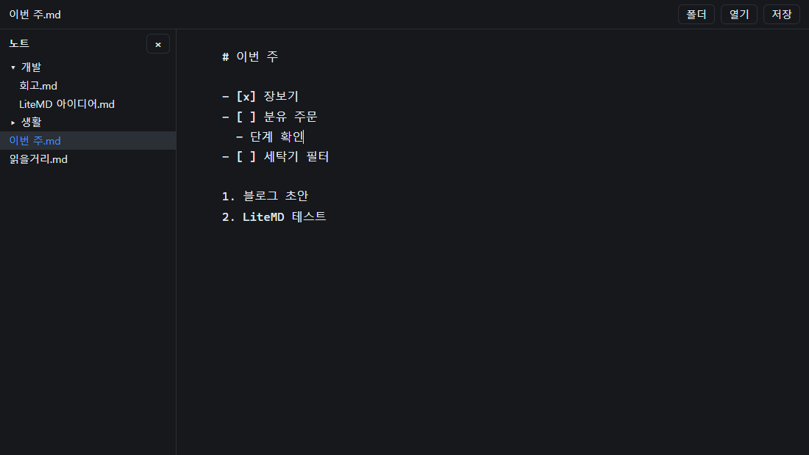

# LiteMD

HTML 파일 한 장(외부 라이브러리 0, 20KB 이하)으로 된 초경량 마크다운 에디터.

*A featherweight Markdown editor in a single HTML file — no dependencies, under 20 KB.*



## 쓰는 법

`index.html`을 크롬이나 엣지로 연다. 설치·빌드 없음.

| 키 | 동작 |
|---|---|
| Ctrl+O / Ctrl+S | 열기 / 저장(연 파일에 바로 덮어쓰기) |
| Shift+[저장] | 다른 이름으로 저장 (크롬은 Ctrl+Shift+S도 — 엣지는 이 키가 웹 캡처) |
| [폴더] | 폴더를 열어 왼쪽에 트리. 파일을 누르면 열린다 |
| Enter | 목록 이어쓰기: `-` `*` `+` `1.` `1)` `- [ ]` (체크된 할 일은 빈 칸으로) |
| 빈 항목에서 Enter | 하위 항목이면 한 단계 내어쓰기, 최상위면 목록 끝 |
| Shift+Enter | 이어쓰기 없이 줄바꿈 |
| Tab / Shift+Tab | 들여쓰기 / 내어쓰기 (공백 2칸, 여러 줄 선택 가능) |

- 한글 조합 중 Enter·Tab은 건드리지 않는다(글자 겹침 없음). 자동으로 넣은 글은 Ctrl+Z 한 번에 되돌아간다
- 저장 안 한 변경은 `•`로 표시하고, 그 상태로 닫거나 다른 파일을 열면 확인한다
- CRLF 파일은 CRLF로 저장한다. BOM은 저장하면 빠진다
- 탐색기는 `.md`·`.markdown`·`.txt`만 보이고 `.git`·`.obsidian`처럼 점으로 시작하는 건 숨긴다
- File System Access API가 없는 브라우저(폰·파이어폭스·사파리)에서는 파일 선택으로 열고 다운로드로 저장한다. 폴더 탐색기는 안 보인다

## 일부러 안 하는 것

미리보기·렌더링, 라이브 프리뷰, 레벨별 접기, 구문 강조, 여러 탭, 찾기·바꾸기. textarea 한 장으로 버티는 게 이 버전의 규칙이다. 라이브 프리뷰와 접기는 편집기 바닥을 바꿔야 해서 다음 버전 몫이다.

## 구조

```
index.html              전부
  <script id="logic">   순수 함수: 목록 이어쓰기·들여쓰기·줄바꿈·단축키·탐색기 정렬 (DOM 없음)
  <script>              화면: 편집창·파일 입출력·탐색기·단축키
tests/vectors.mjs       검증 예시(입력 → 기대 출력)
tests/logic.test.mjs    logic 블록만 떼어 Node에서 도는 단위 테스트 + 크기·외부 리소스 검사
tests/browser.test.mjs  크롬·엣지 headless에 실제 키 이벤트를 보내는 브라우저 테스트
tests/cdp.mjs           Chrome DevTools Protocol 클라이언트 (Node 내장 WebSocket, npm 의존성 0)
```

## 테스트

```
node --test "tests/*.test.mjs"
```

Node 22 이상. 브라우저 테스트는 크롬·엣지가 기본 설치 경로에 있으면 임시 프로필로 띄운다(다른 경로면 `CHROME_PATH`·`EDGE_PATH`). 파일 대화상자는 띄울 수 없어서 페이지 안에서 가짜 파일·폴더 핸들로 바꿔 끼운다.

## 왜 만들었나

매달 하나씩 끝까지 만들어 보는 연습의 0호(2026년 10월).
