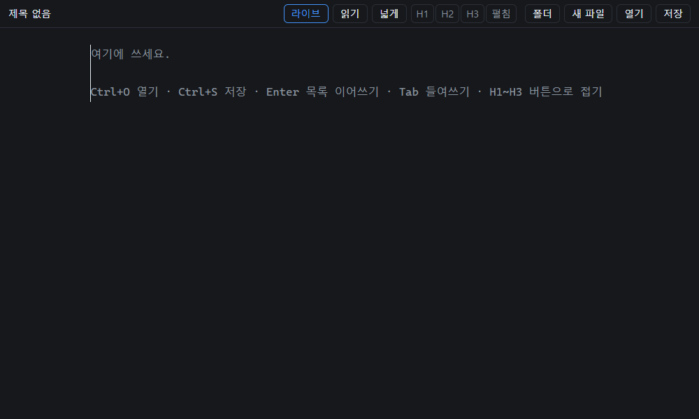

# LiteMD

**한국어** · [English](README.en.md)

HTML 파일 한 장으로 된 마크다운 에디터. 옵시디언처럼 쓰면서 바로 보이는 라이브 프리뷰, 다 그린 읽기 화면, 헤딩 단위 접기. CodeMirror 6을 번들해서 외부 요청 없이 오프라인으로 돈다(약 380KB).

*A Markdown editor in a single HTML file — live preview, reading view, heading folding, no network requests, works offline.*

**써 보기:** https://jckim0721.github.io/LiteMD/ · 0호(textarea 한 장, 16.5KB): https://jckim0721.github.io/LiteMD/v1/



## 쓰는 법

위 주소를 크롬이나 엣지로 열거나, `index.html`을 내려받아 연다. 설치 없음, 인터넷 없이도 돈다.

| 키·버튼 | 동작 |
|---|---|
| Ctrl+O / Ctrl+S | 열기 / 저장(연 파일에 바로 덮어쓰기) |
| Shift+[저장] | 다른 이름으로 저장 (크롬은 Ctrl+Shift+S도 — 엣지는 이 키가 웹 캡처) |
| [폴더] | 폴더를 열어 왼쪽에 트리. 파일을 누르면 열린다 |
| [라이브] | 라이브 프리뷰 켜기·끄기(기본 켬): 커서가 없는 줄은 `#`·`**`·링크 주소 같은 기호를 숨기고, 할 일은 체크박스(눌러서 체크), 글머리는 `•` |
| Ctrl+클릭 | 링크를 새 탭으로(그냥 클릭은 편집) |
| Ctrl+E · [읽기] | 읽기 화면 ↔ 편집 화면. 표·이미지까지 다 그린다 |
| 헤딩 왼쪽 ▾ / ▸, 접힌 자리 ⋯ | 그 헤딩 섹션 접기 / 펴기 |
| [H1] [H2] [H3] [펼침] | n단계 헤딩까지만 보이게 접기 / 모두 펴기 |
| Ctrl+Shift+[ / Ctrl+Shift+] | 커서가 있는 섹션 접기(다시 누르면 한 단계 바깥) / 펴기 |
| Ctrl+F | 찾기·바꾸기 (접힌 곳에서 찾으면 그 부분이 펴진다) |
| Enter | 목록 이어쓰기: `-` `*` `+` `1.` `1)` `- [ ]` (체크된 할 일은 빈 칸으로) |
| 빈 항목에서 Enter | 하위 항목이면 한 단계 내어쓰기, 최상위면 목록 끝 |
| Shift+Enter | 이어쓰기 없이 줄바꿈 |
| Tab / Shift+Tab | 들여쓰기 / 내어쓰기 (공백 2칸, 여러 줄 선택 가능) |

- 라이브 프리뷰는 줄 단위다. 커서·선택이 걸친 줄은 원문 그대로라 고치기 쉽고, 한글을 조합하는 동안 화면이 흔들리지 않는다
- 읽기 화면은 HTML을 실행하지 않고 글자로 보여 주고, `javascript:` 같은 위험한 주소는 막는다
- 접기는 보기만 바꾼다. 접힌 채 저장해도 전체 글이 저장된다
- 한글 조합 중에는 키를 가로채지 않는다(글자 겹침 없음). 자동으로 넣은 글은 Ctrl+Z 한 번에 되돌아간다
- 저장 안 한 변경은 `•`로 표시하고, 그 상태로 닫거나 다른 파일을 열면 확인한다
- CRLF 파일은 CRLF로 저장한다. BOM은 저장하면 빠진다
- 탐색기는 `.md`·`.markdown`·`.txt`만 보이고 `.git`·`.obsidian`처럼 점으로 시작하는 건 숨긴다
- File System Access API가 없는 브라우저(폰·파이어폭스·사파리)에서는 파일 선택으로 열고 다운로드로 저장한다. 폴더 탐색기는 안 보인다

## 폐쇄망·오프라인에서 쓰기

[릴리스](https://github.com/jckim0721/LiteMD/releases)에서 판마다 붙은 파일 하나(`LiteMD-v3.0.html` 등, `index.html`과 같은 파일)만 옮기면 된다. 편집기 엔진·아이콘까지 전부 안에 들어 있고 외부 요청이 0이라 인터넷이 없어도 된다. 설치·서버 없음.

- 브라우저: 크롬·엣지 110 이상 권장(`edge://version`으로 확인)
- 회사 정책으로 파일 열기 API가 막혀 있으면 열기는 파일 선택 창, 저장은 다운로드로 자동으로 바뀐다
- 새 판이 나오면 파일만 바꿔 넣는다. 브라우저가 오래됐으면 가벼운 0호 `LiteMD-v1.0.html`(textarea 한 장, 16.5KB)

## 버전

판마다 [릴리스](https://github.com/jckim0721/LiteMD/releases)에 실행 파일 하나가 붙어 있다. 판끼리 차이는 [CHANGELOG.md](CHANGELOG.md).

- **v3.0 (지금):** 라이브 프리뷰·읽기 프리뷰(Ctrl+E), 체크박스, 링크 Ctrl+클릭
- **v2.0:** CodeMirror 6 — 헤딩 접기·레벨 접기·찾기, 기본 강조. 하위 항목이 있는 목록·코드 블록도 접힌다(마크다운 기본 접기)
- **v1.0 (`/v1/`):** textarea 한 장, 외부 라이브러리 0, 16.5KB. 목록 이어쓰기·들여쓰기·열기/저장·폴더 탐색기


## 구조

```
src/index.html      화면 틀(HTML·CSS)
src/app.js          편집기·파일 입출력·탐색기·단축키
src/logic.js        순수 함수: 목록 이어쓰기·들여쓰기·줄바꿈·단축키·탐색기 정렬·레벨 접기 대상
src/folding.js      헤딩 섹션 찾기(마크다운 구문 트리)와 접기 명령
src/livepreview.js  라이브 프리뷰: 줄마다 숨길·바꿀 범위(previewSpans)와 화면 꾸밈, 체크박스, Ctrl+클릭
src/render.js       읽기 프리뷰: 마크다운 → HTML(같은 파서), 주소 거르기(safeUrl)
build.mjs           src/를 묶어 루트 index.html 한 장으로 (라이선스 고지 포함)
index.html          빌드 결과물 — 이걸 열면 된다
tests/              단위 테스트(Node) + 크롬·엣지 headless 브라우저 테스트(CDP, 별도 도구 없음)
```

## 빌드·테스트

```
npm install
npm run build      # index.html 생성
npm test           # node --test "tests/*.test.mjs"
```

Node 22 이상. 브라우저 테스트는 크롬·엣지가 기본 설치 경로에 있으면 임시 프로필로 띄운다(다른 경로면 `CHROME_PATH`·`EDGE_PATH`). 파일 대화상자는 띄울 수 없어서 페이지 안에서 가짜 파일·폴더 핸들로 바꿔 끼운다.

## 라이선스

MIT — [LICENSE](LICENSE). 번들에 들어간 라이브러리(CodeMirror·Lezer 등, 모두 MIT)의 고지문은 `index.html` 맨 위 주석에 있다.

`docs/demo.png`는 움직이는 PNG(APNG)다. `node tools/demo.mjs`가 실제 조작을 찍어 만든다.

## 왜 만들었나

매달 하나씩 끝까지 만들어 보는 연습. v1이 0호(2026년 10월), v2가 1호, v3가 2호.
